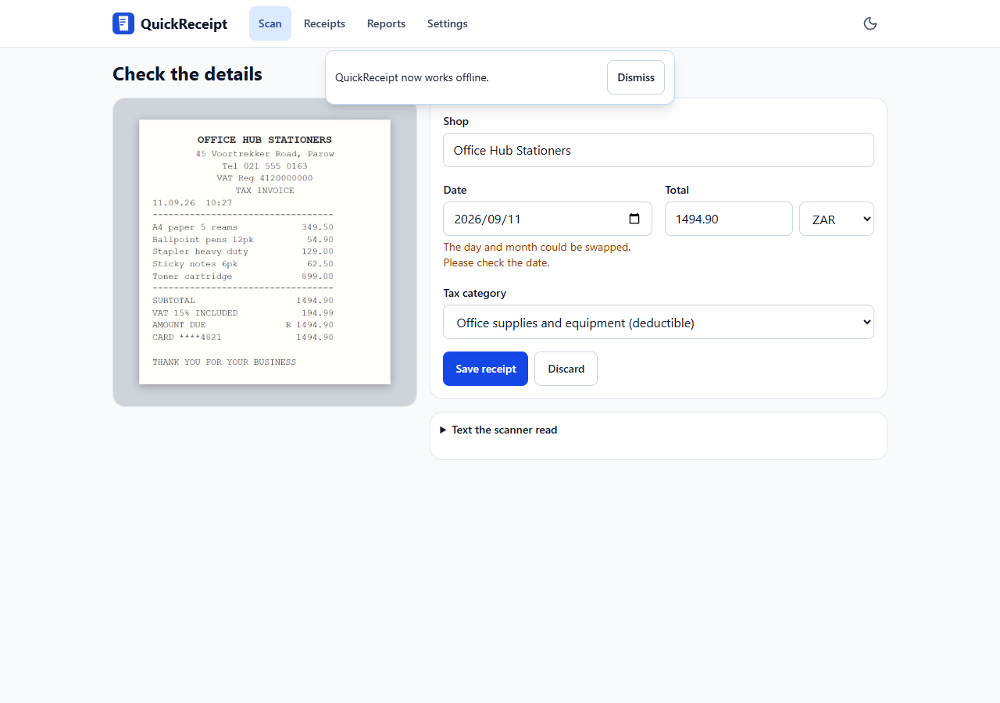
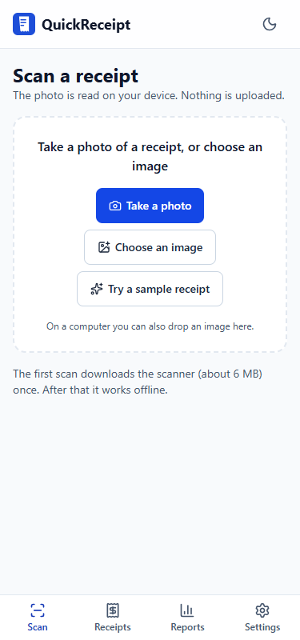
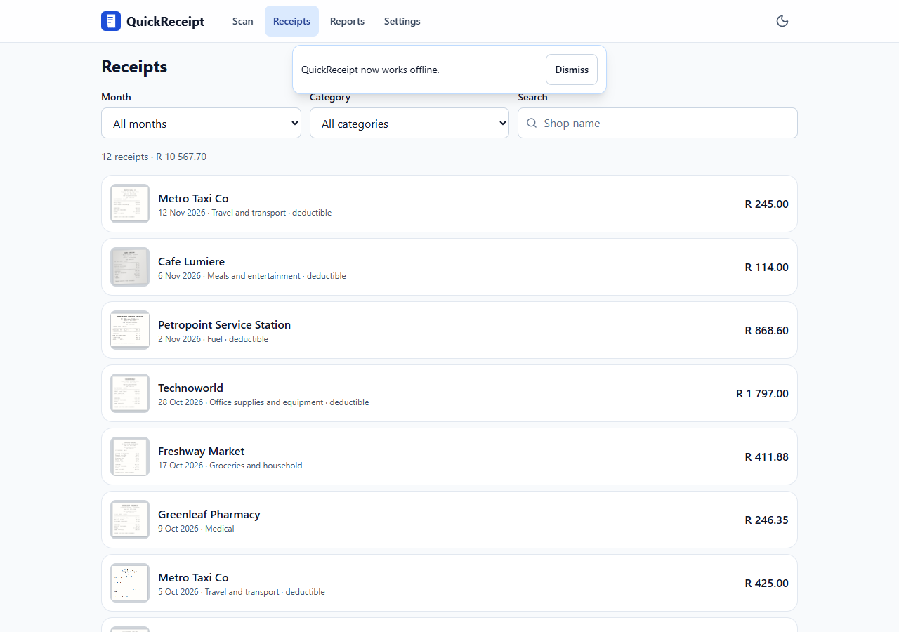
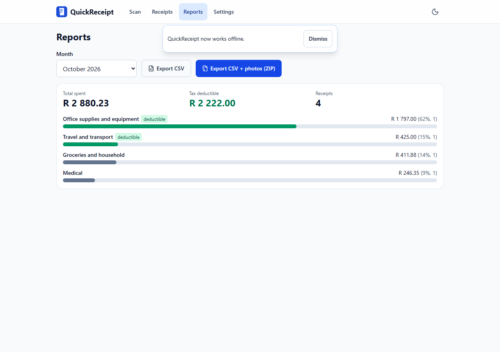
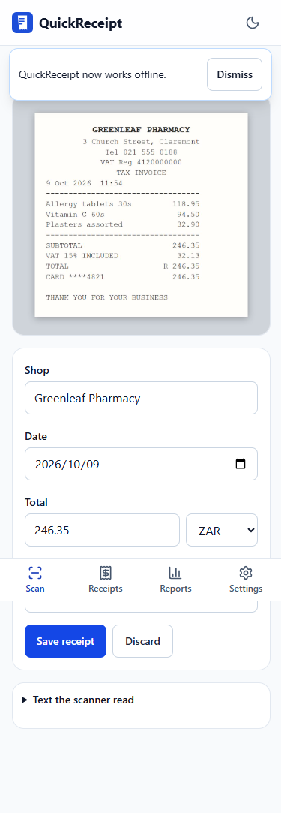

# QuickReceipt

Snap a receipt and the app reads it on your device, pre-filling the shop, date and total. Sort receipts into tax categories, see monthly totals, and export a CSV and a ZIP with the photos. No account, no server, and it works offline.

**Live demo:** coming soon (built and tested locally; not deployed yet)
**Run locally:** see [Run locally](#run-locally)



## What to demo to a recruiter

1. **Scan a receipt:** press *Try a sample receipt* (or upload a photo). The scanner runs in a Web Worker with a progress bar, fills in shop, date and total, and flags the fields it is unsure about, such as a date that could be day/month or month/day.
2. **Monthly report and export:** open Reports, pick a month, see spending by tax category with the deductible total, and download a CSV or a ZIP of the CSV plus the receipt photos.
3. **Works with no connection:** after the scanner has been downloaded once, turn on airplane mode and scan, save and export anyway. Nothing is ever uploaded.

## Features

- **On-device OCR:** Tesseract.js in a Web Worker, with the engine and English data served from this site's own `/tesseract` folder. There is no CDN, so it works offline once cached.
- **Parser with confidence hints:** finds the merchant, the date (many formats, ambiguous ones flagged) and the total (the line labelled total, not just the biggest number), and repairs common scanner mistakes such as `O` for `0`. Every field stays editable.
- **Photos kept small:** images are shrunk to at most 1800 px and stored as JPEG Blobs in IndexedDB.
- **Receipts:** list with photo thumbnails, filters by month and category, search, and a window to view, edit and delete.
- **Tax categories:** eight defaults you can rename, mark as deductible, add to and delete (receipts in a deleted category move to *Other*). The category is suggested from what you chose last time for the same shop, or from words in its name.
- **Reports:** totals per month and per category with shares, a deductible total, and separate sections per currency (currencies are never added together).
- **Export:** a CSV (Excel-safe, and protected against spreadsheet formula injection) or a ZIP with the CSV and every photo, named to match its row.
- **PWA:** installable, offline-first, with an update banner that waits for you to tap Reload. Light and dark themes.

**Phase 2 (not built):** line-item extraction, image pre-processing (grayscale, deskew), full multi-currency conversion, optional Neon sync.

## Stack

React 19, Vite, TypeScript (strict), Tailwind CSS v4, Tesseract.js 7, Dexie (IndexedDB), JSZip, `vite-plugin-pwa`, Vitest with `fake-indexeddb`. No backend, no accounts, no secrets.

## How accurate is the scanner?

Measured on the twelve sample receipts (made-up shops, drawn by `scripts/make-sample-receipts.ts`, one of them tilted and softened like a quick photo):

| Image given to the scanner | Lines read exactly right | Dates right | Merchant and total right |
| --- | --- | --- | --- |
| Lossless copy of the shrunk photo (what the app uses) | 173 of 173 | 12 of 12 | 12 of 12 |
| JPEG at quality 0.92 | 133 of 173 | 8 of 12 | 12 of 12 |
| JPEG at quality 0.82 (what is stored) | 130 of 173 | 9 of 12 | 12 of 12 |

JPEG blurs the thin strokes of receipt print and causes misreads such as `129.00` becoming `129.06`, so the app stores the small JPEG but reads a lossless copy of the same pixels that is never saved.

These are clean computer-drawn receipts, so treat the 100% as an upper bound. Real receipts (faded thermal paper, creases, shadows, angled photos) will be read worse, which is exactly why every field is shown for checking before saving and uncertain ones are flagged. Only English is supported. I have not tested it on a large set of real photographed receipts.

## Architecture notes

- **The scanner is served from your own origin.** `scripts/copy-ocr-assets.mjs` copies the worker, the three WebAssembly engine builds (a visitor downloads one) and the English data from `node_modules` into `public/tesseract` before `dev` and `build`. They are not committed (about 14 MB). Tesseract's own IndexedDB cache is off, so the service worker cache is what offline use depends on, and the offline test proves it.
- **Cached on first use, not on install.** The scanner (about 6 MB) is not precached with the app; the service worker caches it the first time it is used, or when you press *Download the scanner for offline use* in Settings. The service worker takes control on the first visit (`clientsClaim`) so even the very first scan is cached, while app updates still wait for the user.
- **Parsing is one pure, tested module** (`lib/parser.ts`) with sample receipt strings and real scanner outputs (mistakes included) as fixtures. It ignores phone and registration lines when judging amounts and rejects junk lines such as `EEE` as shop names.
- **Money is added in whole cents**, so a report never shows floating point noise.
- **The CSV is hardened.** Scanned text is untrusted, so a cell starting with `=`, `+`, `-` or `@` gets a leading apostrophe and cannot run as a formula in Excel or Sheets.
- **Start-up stays light.** The demo receipts (twelve images) are added only after the page has loaded and a short grace period, so on a slow connection they never compete with the first screen. Receipts, Reports and Settings, the OCR engine and JSZip all load on demand.
- Deleting a category moves its receipts to *Other* in the same transaction; replacing all receipts is one transaction too.

```
src/lib/        parser, money, dates, csv, zip, reports, categorise, image, ocr, IndexedDB layer (tested)
src/data/       the twelve sample receipts: one source for the images, the demo rows and the parser fixtures
src/features/   scan, receipts, reports, settings
scripts/        copy-ocr-assets.mjs (build step), make-sample-receipts.ts (draws the sample images)
```

## Performance

Measured on the production build:

| Condition | Result |
| --- | --- |
| Lighthouse, mobile profile with simulated slow 4G | Performance 98, Accessibility 100, Best Practices 100, SEO 100; simulated LCP 2.0 s |
| Observed in that same run | first paint 246 ms, largest paint 329 ms |
| Unthrottled, fresh profile | first paint about 240 ms, largest paint about 260 ms |
| Reading one receipt, scanner already loaded | about 0.3 to 0.4 s per receipt |

The first scan has to download the scanner (about 6 MB); on a slow mobile connection that takes a while, which is why Settings offers to download it ahead of time.

## Run locally

Requires Node 22 or later.

```bash
npm install
npm run dev          # http://localhost:5310  (copies the OCR files first)
```

To try the installable, offline build: `npm run build && npm run preview` (http://localhost:4180).
Other scripts: `npm run lint`, `npm run typecheck`, `npm test`.

## Screenshots

| Scan (phone) | Receipts | Reports |
| --- | --- | --- |
|  |  |  |



## Verified

Typecheck, lint and build pass, and 120 automated tests pass (parser including real scanner output, categories, reports, CSV and ZIP, amounts, seeding and the IndexedDB layer). A 76-check browser run (Playwright, Chromium) against the production build covered real OCR through the file input, flagging uncertain fields, validation, correcting a total typed with a comma, the date-order setting, editing and deleting, filters and search, category add, rename and delete, report totals checked against the sample data, CSV and ZIP contents (names, images and totals), **scanning and saving with the network switched off**, delete-everything and reload, and 375px layouts with no overflow and no console errors. Not yet checked: real photographed receipts, a real phone (camera capture, install), and deployment on Netlify.
